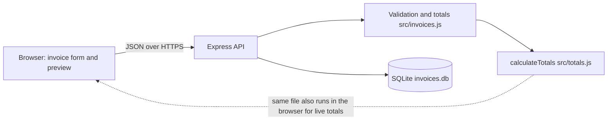

# Martha's Cuisines Invoice App

A small web app for a Ghanaian catering business. Create a branded invoice from a package (Bronze, Silver or Gold), guest count, dishes and extras. Save it, find it again, mark it paid, print it as a PDF, and send a WhatsApp message to the client.

## Run it

Needs Node.js 22.13 or newer.

```bash
npm install
```

Copy `.env.example` to `.env` and set `INVOICE_PASSWORD` (at least 8 characters). Then:

```bash
npm run dev
```

Open http://localhost:3000 and log in.

```bash
npm test
```

runs all tests (17). `npm run backup` saves a safe copy of the database into `backups/`.

## How it fits together



- **Money is whole pesewas** (100 pesewas = 1 cedi), never decimals, so totals cannot drift.
- **`src/totals.js` is the single source of truth.** The browser uses it for live totals. The server runs it again and stores its own answer, ignoring any total the browser sends.
- **Invoice numbers** (MC-0001, MC-0002) are assigned by the server inside a database transaction.
- **Login** is one shared password with a signed, expiring cookie, and a limit of 5 wrong tries per minute.
- **Drawing the invoice** uses `textContent`, never raw HTML, so client names cannot inject code.

## Folders

| Path | What it holds |
|---|---|
| `public/` | Pages, styles, browser scripts, the logo (never edited) |
| `src/` | Server, database, totals and money logic, menu and rate card |
| `test/` | Tests for totals, money, the API and WhatsApp links |
| `scripts/backup.js` | Database backup |
| `docs/` | Design and build plan |

## Brand rules

Burnt orange (`#B83A00`, from the logo), black and white are the main colours. Other colours appear only for status and errors. `logo.jpeg` is used exactly as supplied.

## Deploying

The app needs a host that runs Node (or Docker) and keeps a **persistent disk**, because the database is a file. Without a disk, every deploy erases the invoices.

1. Build from the `Dockerfile`, or run `node src/server.js` with Node 22.
2. Set these environment variables on the host, never in the code:
   - `INVOICE_PASSWORD`: the shared password
   - `SESSION_SECRET`: a long random string, so people stay logged in after restarts
   - `TRUST_PROXY=1`: when the host puts HTTPS in front of the app
3. Mount a persistent disk at `/data` (the Docker image stores the database at `/data/invoices.db`).
4. Run `npm run backup` on a schedule, or download the database file regularly.

## Measured on a laptop

Local run, 100 saves in a row from the browser: median 14 ms and 95th percentile 29 ms per save. Searching the list: median 9 ms. These are local numbers and will be higher on a hosted server.

## Known limits

- One shared password, no separate users.
- Prices and menu live in `src/packages.js` and `src/menu.js`, so changing them needs a code edit.
- WhatsApp links cannot attach files: save the PDF, then attach it in the chat that opens.
- No tax or VAT line yet.
